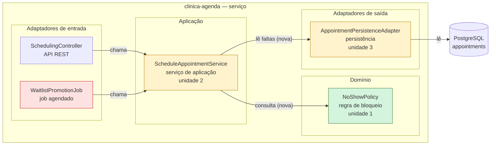

# Diagrama de componentes da ITS

Parte do `its-generator`, lida só quando o arquiteto aceita, depois da entrega da ITS, a sugestão de desenhar o diagrama de componentes. Numa execução em que ele não aceitou, este arquivo não é lido.

O diagrama é o nível 3 do modelo C4 — os componentes de dentro de um contêiner — recortado à mudança: mostra onde a ITS entra no serviço, o que ela cria, o que modifica e quem depende do que muda. Ele serve a quem lê a ITS e a quem revisa o PR. Não é instrução: quem implementa segue a ITS.

## Regras

- **Derivado da ITS, nunca fonte.** Todo elemento do diagrama está na ITS: um componente que uma unidade cria ou modifica, um dependente que a ITS trata como ponto de regressão, teste a alterar, fronteira de fora de escopo ou risco, ou um elemento externo que uma unidade toca. Nada novo entra pelo diagrama.
- **Nenhuma leitura nova de código.** O diagrama sai da ITS e das notas da inspeção desta sessão. Numa sessão nova, sai só da ITS.
- **Divergência é defeito da ITS.** Se, ao desenhar, aparecer um dependente que a ITS não trata, não o acrescente em silêncio ao diagrama: reporte ao arquiteto e revise a ITS pelo caminho de revisão (`revising-an-its.md`). O diagrama é refeito depois.
- **Um contêiner.** A fronteira é o serviço do projeto. Outros serviços, bancos, filas e sistemas externos aparecem fora dela, só quando uma unidade os toca.

## O arquivo

- **Caminho:** na mesma pasta da ITS, com o mesmo nome e o sufixo `-componentes`: `ITS-<story-id>-titulo-curto-componentes.md`.
- **Formato:** sempre Markdown com um bloco Mermaid, seja qual for o formato da ITS — como os casos de uso e os ADRs.
- **Conteúdo, nesta ordem:**
  1. o título `# Componentes — ITS-<story-id> — <título da story>`;
  2. uma linha dizendo que o diagrama é derivado da ITS, que vale o texto dela e que todo número de unidade se refere a ela;
  3. o bloco Mermaid;
  4. a legenda das quatro marcas, em uma linha.

## Como desenhar

O C4 não exige uma notação. O diagrama usa `flowchart` do Mermaid, porque a sintaxe C4 do Mermaid ainda é experimental.

- **Fronteira do contêiner:** um `subgraph` com o nome do serviço. Dentro dele, um `subgraph` por camada que a seção Estrutura da configuração declara — numa arquitetura hexagonal: adaptadores de entrada, aplicação, domínio e adaptadores de saída. Camada sem componente no diagrama não aparece.
- **Componente:** um nó com o nome do tipo, o papel em poucas palavras e, quando a ITS o altera, a unidade: `ScheduleAppointmentService<br/>serviço de aplicação<br/>unidade 2`.
- **Elemento externo:** fora da fronteira, com o tipo — banco, fila, sistema externo — e o nome.
- **Relação:** uma seta com o verbo — chama, implementa, publica, lê, grava. Uma relação que a ITS cria leva `(nova)` no rótulo.
- **As quatro marcas,** por `classDef`:
  - **criado** — o componente leva `(criar)` na ITS;
  - **modificado** — uma unidade o altera;
  - **dependente** — a ITS o trata como ponto de regressão, teste a alterar ou risco;
  - **fora de escopo** — está em "Fora de escopo — não alterar".
  - Um componente sem marca aparece só quando é necessário para ligar dois marcados.
- **Tamanho:** até cerca de 15 nós. Acima disso, agrupe os dependentes de um mesmo tipo num nó só ("4 consumidores do evento X") e diga quais são na legenda.

Exemplo da forma:

````markdown

````

## Ao revisar a ITS

Quando a ITS é revisada e o arquivo do diagrama existe, ele é refeito na mesma revisão. Um diagrama que não bate com a ITS em vigor é pior que nenhum.

## Entrega

Uma linha: o caminho do arquivo. Se o desenho revelou divergência com a ITS, ela vem antes, e o arquivo só é escrito depois da revisão.
