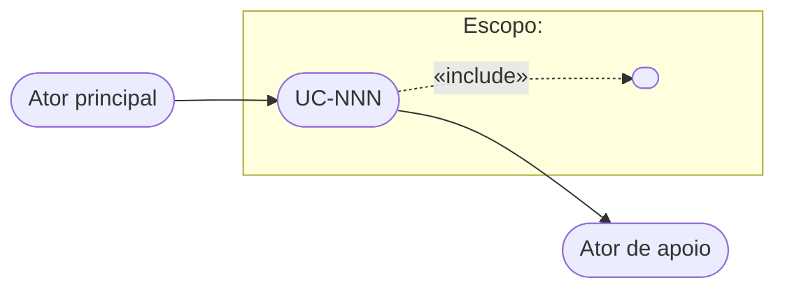

# Template de Caso de Uso

Este é o template canônico — a cópia única, de propriedade do prime-architect/use-case. Se o `prime-config.md` do projeto declarar um caminho de template customizado ou seções obrigatórias adicionais, a configuração do projeto tem precedência.

**Idioma.** O bloco do artefato abaixo é o documento que quem escreve produz, e é escrito no idioma de documento deste formato: `pt-BR`. Os títulos de seção fazem parte do artefato e por isso são traduzidos; os **tokens estáveis** que este formato declara — identificadores (`UC-NNN`, `RN-N`, `CA-N`, `S-NNN`), valores de status (`Draft`, `Reviewed`, `Retired`), os marcadores de incerteza (`[INFERRED]`, `[CONFIRM: ...]`), padrões de nomenclatura de arquivo e caminhos — nunca são traduzidos, em nenhum idioma.

## Convenção de nomenclatura de arquivo

`use-cases/UC-NNN-titulo-curto.md` (por exemplo, `UC-042-exportar-relatorio-pdf.md`), sob a raiz de documentos que a configuração do projeto declara — `docs/` quando a documentação vive no repositório do código. `NNN` é um número sequencial com zeros à esquerda, estável durante toda a vida do documento. Nunca renumere casos de uso existentes nem reaproveite um número: o próximo documento recebe o maior número já usado no repositório + 1. Por isso um documento nunca é apagado — o que deixa de descrever um comportamento vivo permanece no mesmo caminho, com Status `Retired` (veja Ciclo de vida do status). O slug segue o idioma do documento; o prefixo `UC-NNN` não.

## Granularidade

Um documento descreve **um objetivo de um ator** — o que o ator quer conseguir —, não uma tela, um endpoint ou uma operação de dados.

- **Nível.** `Objetivo de usuário` é o padrão: o ator conclui o objetivo numa sessão de trabalho e sai com algo de valor (Comprar mercadoria, Exportar relatório). `Subfunção` é um trecho que só existe como parte de outros casos de uso (Autenticar cliente, Calcular frete) e só vira documento próprio quando dois ou mais o incluem («include»); antes disso, é passo de quem o usa. `Resumo` agrupa objetivos de usuário num processo de negócio maior (Gerenciar contrato) e só existe quando alguém precisa do mapa desse processo.
- **Extensão ou caso de uso próprio.** É extensão o que ocorre num passo deste fluxo e volta a ele ou o encerra — uma falha, uma alternativa, um desvio. É caso de uso próprio o que dá ao ator um objetivo distinto, que faria sentido iniciar sozinho, ou o desvio que cresce até ter cenário e extensões próprios.
- **Pontos de entrada não são casos de uso.** Endpoints, telas, jobs e consumidores de mensagem são superfícies: várias costumam servir a um mesmo objetivo (iniciar, consultar o andamento, confirmar), e uma pode servir a vários. Agrupe pelo objetivo do ator. As operações de cadastro de uma mesma entidade são, em regra, um caso de uso (Manter cadastro de X); separe só a operação que tem regras, atores ou extensões próprios.
- **Sinais de tamanho.** Um cenário principal com mais de nove passos, ou extensões que viram fluxos inteiros, pede divisão (veja Reorganização entre documentos). Um documento sem extensão nem regra, que só repassa a chamada a outro, provavelmente é um passo de outro caso de uso.

## Estabilidade dos identificadores internos

Os identificadores de dentro do documento são citados de fora dele — pelo delta, pelas Referências da ITS, pelo code review (`UC-042/CA-2`) e por outros casos de uso. Por isso:

- **`RN-N` e `CA-N` nunca são renumerados nem reaproveitados.** Uma regra ou um critério removido permanece na seção como lápide — `**RN-4:** removida (S-NNN)` —, para que o número não volte a ser usado e citações antigas continuem resolvendo; o parêntese leva a origem da entrada que o removeu (o ID da story, ou `reconciliação com o código`). Um item que passa a outro documento numa reorganização também vira lápide, apontando o novo endereço — `**RN-4:** movida para UC-060/RN-1 (revisão editorial)`. Um item novo recebe o número seguinte ao maior já usado no documento.
- **Passos e extensões são posicionais.** Podem ser renumerados quando a sequência muda, e o rótulo de cada extensão acompanha o passo a que se liga. Toda renumeração é declarada na entrada do Histórico de revisões, e o delta cita a numeração resultante (ex.: "Adicionado passo 4; passos 4–6 renumerados para 5–7; extensão 4a passa a 5a"). Uma renumeração leva junto os rótulos dos critérios de aceite deste documento — atualização derivada, que não é item de delta — e exige verificar as referências aos passos em outros casos de uso.

## Reorganização entre documentos

Dividir um caso de uso que cresceu demais, incorporar um caso de uso a outro ou mover uma regra para o documento a que ela pertence muda onde o comportamento está descrito, não o comportamento. É sempre uma revisão editorial (veja Regras do Histórico de revisões) e nunca trabalho para o ITS Generator.

- **Divisão.** O documento de origem mantém o número e perde os itens movidos: cada `RN-N` e `CA-N` movido vira lápide que aponta o destino, e os passos e extensões que saem são declarados no Resumo, junto com a renumeração do que fica. O documento novo recebe o próximo número, numera suas `RN-N` e `CA-N` a partir de 1 e nasce em `Draft`, com uma entrada de revisão editorial que nomeia a origem.
- **Incorporação.** O documento que absorve numera os itens recebidos a partir do maior número que já usa. O absorvido passa a `Retired`, com o corpo congelado; sua entrada de revisão editorial nomeia o destino e traz o mapa de identificadores antigos para novos, para que uma citação antiga ainda chegue ao endereço atual.
- **Nunca na mesma entrada que o delta de uma story.** Reorganizar e mudar comportamento juntos tornaria o delta inseparável do que só mudou de lugar. Primeiro a revisão editorial, validada e promovida pelo arquiteto; depois o delta, sobre a base reorganizada.

## Forma das regras de negócio

Toda `RN-N` é uma frase num dos padrões abaixo, adaptados do EARS (Easy Approach to Requirements Syntax). A forma fixa tira da regra a escolha de redação: quem escreve não decide como enunciá-la, quem lê não interpreta o enunciado, e a regra chega ao critério de aceite e à ITS sem tradução.

| Padrão | Forma | Uso | Exemplo |
|---|---|---|---|
| Ubíquo | O sistema <resposta>. | Vale sempre: cálculo, derivação, limite fixo | O sistema calcula o frete como 10% do subtotal, com mínimo de R$ 15,00. |
| Por evento | Quando <gatilho>, o sistema <resposta>. | Reação a algo esperado que acontece no fluxo | Quando o pedido for confirmado, o sistema reserva o estoque de cada item por 30 minutos. |
| Por estado | Enquanto <estado>, o sistema <resposta>. | Vale durante um estado do objeto ou do ator | Enquanto a fatura estiver em disputa, o sistema suspende a cobrança de juros sobre ela. |
| Indesejado | Se <condição indesejada>, então o sistema <resposta>. | Falha, violação de limite, entrada inválida ou ausente | Se o total do pedido exceder o limite de crédito vigente do cliente, então o sistema rejeita a confirmação. |
| Opcional | Onde <característica>, o sistema <resposta>. | Depende de configuração, contrato ou variante de produto | Onde o contrato do cliente incluir faturamento consolidado, o sistema agrupa os pedidos do mês numa única fatura. |

- **Combinações.** Os padrões se combinam na ordem Onde → Enquanto → Quando ou Se: "Enquanto o cliente estiver inadimplente, quando ele solicitar um novo pedido, o sistema exige pagamento antecipado."
- **Sujeito e verbo.** O sujeito é sempre "o sistema", e a resposta fica no presente do indicativo, como nos passos do cenário. Nunca "deve", "deverá" ou "pode": a força normativa vem do Status `Reviewed`, não do verbo.
- **Uma resposta por regra.** Uma segunda resposta é outra regra, um passo de extensão ou uma garantia.
- **Permissão é resposta do sistema.** "O cliente pode cancelar até 24 h antes" não diz o que o sistema faz com o cancelamento tardio; a regra diz: "Se o cliente solicitar o cancelamento com menos de 24 h de antecedência, então o sistema recusa o cancelamento."
- **O valor vive na regra.** Números, prazos e limites ficam na regra; a extensão que a aplica cita o ID e não repete o valor.
- **A regra nunca cita o fluxo.** Passos e extensões são posicionais e se renumeram: o gatilho é escrito em termos de negócio, e o fluxo cita a regra, nunca o contrário.
- **Indesejado pede extensão.** Toda regra `Se … então` é citada por ao menos uma extensão — é ali que o fluxo diz como termina.
- **Lápides.** Não seguem padrão.
- **Regras anteriores a esta forma.** A forma vale para a regra escrita ou alterada. Uma regra que a story não altera mantém a redação até uma revisão editorial convertê-la; convertê-la dentro da entrada da story poria no delta um item sem mudança de comportamento.

## Estrutura do documento

````markdown
# UC-NNN — [Título do caso de uso]

| Campo | Valor |
|---|---|
| **ID** | UC-NNN |
| **Nome** | O objetivo do ator principal, em verbo + objeto (ex.: *Comprar mercadoria*) |
| **Escopo** | O sistema em consideração (sistema de software, subsistema ou organização) |
| **Nível** | Resumo · Objetivo de usuário · Subfunção (veja Granularidade) |
| **Atores** | Quem tem o objetivo que este caso de uso satisfaz (ator principal; atores secundários, se houver) |
| **Casos de uso relacionados** | Links UC-XXX, ou "nenhum". Recíproco: todo UC-XXX citado aqui também cita este documento |
| **Status** | Draft · Reviewed · Retired |

## Envolvidos e interesses

[OPCIONAL — inclua apenas quando o insumo (story, PRD, elicitação, código) revelar interesses dos envolvidos. Omita a seção inteira em vez de inventar conteúdo.]

- **<Envolvido 1>**: <o que espera que o sistema proteja ou garanta>
- **<Envolvido 2>**: <interesse>

## Condições

**Pré-condições**
<O que já é verdade quando o caso de uso começa — garantido por outro caso de uso ou por um controle transversal anterior ao fluxo, como a autenticação — e que este caso de uso não verifica. O que o sistema verifica durante o fluxo e pode falhar é extensão, não pré-condição.>

**Garantias mínimas**
<O que o sistema garante aos envolvidos mesmo se o caso de uso falhar. Ex.: registro de auditoria.>

**Garantias de sucesso**
<O estado do mundo depois que o caso de uso termina com sucesso.>

## Cenário principal de sucesso

1. <Ator> <ação no presente simples, voz ativa>.
2. <Sistema> <ação, citando a regra que a governa quando houver — ex.: conforme RN-1>.
3. <Ator> <ação>.
4. <Sistema> <ação>.
5. <Sistema> <ação que conclui o objetivo>.

## Extensões

[Toda extensão fecha com um desfecho explícito: retorna a um passo numerado ou encerra o caso
de uso, em sucesso ou em falha. Extensão sem desfecho é defeito, não abreviação.]

- **2a.** <Condição alternativa ou de falha no passo 2, citando a regra que a define quando houver — ex.: RN-2>:
  - 2a1. <Ação de tratamento>.
  - 2a2. <Retorna ao passo X | Caso de uso termina em falha>.
- **4a.** <Condição>:
  - 4a1. <Ação>.
  - 4a2. <Retorna ao passo X | Caso de uso termina em falha>.
- ***a.** <Condição que pode ocorrer a qualquer momento>:
  - *a1. <Ação>.
  - *a2. <Retorna ao passo X | Caso de uso termina em falha>.

## Regras de negócio
- **RN-1:** O sistema <resposta>.
- **RN-2:** Se <condição indesejada>, então o sistema <resposta>.
[Toda regra é referenciada pelos fluxos e segue um dos padrões de Forma das regras de negócio. Uma regra removida permanece como lápide — **RN-N:** removida (S-NNN); uma movida a outro documento, como **RN-N:** movida para UC-XXX/RN-M (revisão editorial). Números nunca são reaproveitados.]

## Critérios de aceite
- **CA-1** (cenário principal): Dado [contexto], quando [ação], então [resultado verificável]
- **CA-2** (ext. 2a): Dado [contexto], quando [ação], então [resultado verificável]
- **CA-3** (cenário principal, não funcional): Dado [carga ou condição], quando [ação], então [atributo medido e limite]
[Todo critério precisa ser objetivamente verificável e declara entre parênteses o que cobre: o cenário principal, um passo, uma ou mais extensões ou uma regra (RN-N). O Cenário principal de sucesso e toda extensão aparecem no rótulo de ao menos um critério. Um critério removido permanece como lápide, como nas regras de negócio.]
[Um critério rotulado com uma regra deriva dela: a característica de `Onde` e o estado de `Enquanto` vão para o Dado, o gatilho de `Quando` ou a condição de `Se` vai para o quando, e a resposta vai para o então.]
[Um requisito não funcional deste fluxo — tempo de resposta, volume, disponibilidade, acessibilidade, retenção — é um critério como os outros, com `não funcional` acrescentado ao rótulo e a métrica no resultado (ex.: "então o PDF fica pronto em até 30 s (p95)"). O que vale para o sistema inteiro não se repete em cada caso de uso: é decisão de um ADR. A qualidade interna do código pertence ao prime-core/quality-model e nunca entra num caso de uso.]

## Diagrama UML (resumo gráfico)

[OPCIONAL — inclua apenas quando há relações a mostrar: atores secundários, «include»/«extend»
ou casos de uso relacionados. Com um único ator e nenhuma relação, omita a seção inteira — o
diagrama seria uma bolha só e repetiria o campo Atores.]

[Regra de escopo: o diagrama mostra ESTE caso de uso, seus atores e suas relações diretas
apenas («include»/«extend» e casos de uso diretamente relacionados). Nunca é um mapa do
sistema inteiro — o repositório como um todo é o mapa. Atualize o diagrama sempre que uma
mudança nos fluxos alterar atores ou relações — criando-o quando surge a primeira relação e
removendo-o quando sai a última; atualizações apenas de diagrama NÃO são
itens de delta no Histórico de revisões (o diagrama é derivado dos fluxos — o delta é a
mudança de comportamento).]



## Histórico de revisões
| Rev | Story | Data | Resumo das alterações |
|-----|-------|------|-----------------------|
| 1 | S-NNN, "mapeamento inicial a partir do código", "reconciliação com o código" ou "revisão editorial" | AAAA-MM-DD | [Conforme o tipo da entrada — veja Regras do Histórico de revisões. Numa alteração: itens adicionados/alterados/removidos, referenciando identificadores de passo, extensão e seção — ex.: "Adicionada extensão 3b; alterado passo 5; removida RN-4"] |
[Uma entrada por story. Mantenha apenas as 5 entradas mais recentes. O histórico completo vive no controle de versão.]
````

## Ciclo de vida do status

- **Draft** — em elaboração, ou contendo marcadores de incerteza não resolvidos. Não é fonte de verdade.
- **Reviewed** — validado por um humano; todos os marcadores de incerteza resolvidos. Fonte de verdade do comportamento do sistema; entrada válida para o ITS Generator.
- **Retired** — deixou de descrever um comportamento vivo: o comportamento sai do sistema (entrada de retirada) ou passou a ser descrito por outro documento (incorporação). Não é fonte de verdade do comportamento atual. Permanece no mesmo caminho para que o número nunca seja reaproveitado e as citações antigas continuem resolvendo; seu corpo não é mais editado e ele não volta a outro status — comportamento reintroduzido nasce em um caso de uso novo.

A promoção de Draft para Reviewed é sempre um ato humano — nenhuma skill promove o status por conta própria. Os valores de status são tokens estáveis: escrevem-se `Draft`, `Reviewed` e `Retired` seja qual for o idioma do documento.

O caminho inverso é regra, não julgamento: um documento `Reviewed` volta a `Draft` quando recebe uma entrada de alteração, de reconciliação ou de revisão editorial, ou um marcador de incerteza — o conteúdo novo ainda não foi validado. Quem escreve faz o rebaixamento; o arquiteto promove de novo depois de validar a mudança. Uma entrada de conformidade não rebaixa, porque o corpo do documento não muda; uma atualização apenas de diagrama ou do campo Casos de uso relacionados também não.

A passagem a `Retired` também é regra: quem escreve a faz junto com a entrada de retirada ou com a incorporação, ambas decididas pelo arquiteto ao confirmar o mapeamento. Ela só parte de um documento `Reviewed` e, como o corpo não muda, não pede nova validação. Um documento `Retired` por uma entrada de retirada é a única exceção ao gate do ITS Generator: seu corpo validado é exatamente o que sai do sistema.

## Regras do Histórico de revisões

Toda entrada é de um dos tipos abaixo. O tipo decide o que vai nas colunas Story e Resumo e se a entrada é trabalho para o ITS Generator.

| Tipo | Quem escreve | Story | Resumo das alterações | Trabalho para o ITS Generator |
|---|---|---|---|---|
| Criação | Use Case Creator | ID da story | `Criação` | Sim — o documento inteiro é o delta |
| Alteração | Use Case Creator | ID da story | Itens adicionados/alterados/removidos, com os identificadores de passo, extensão e seção | Sim — os itens são o delta |
| Conformidade | Use Case Creator | ID da story | `Conformidade:` seguido dos identificadores que o código passa a cumprir — ex.: "Conformidade: o código passa a cumprir o passo 5 e o CA-3" | Sim — o corpo não muda; os identificadores citados são o delta |
| Retirada | Use Case Creator | ID da story | `Retirada` | Sim — o documento inteiro é o delta, todo item removido |
| Mapeamento inicial | Use Case Extractor | `mapeamento inicial a partir do código` | O escopo mapeado | Não — é estado |
| Reconciliação | Use Case Creator | `reconciliação com o código` | O que mudou no corpo para descrever o código, como numa alteração | Não — o código já faz isso |
| Revisão editorial | Use Case Creator | `revisão editorial` | O que mudou de redação ou de lugar, com os identificadores; numa reorganização, o documento de origem ou de destino e o mapa de identificadores antigos para novos | Não — o comportamento não muda |

- **Uma entrada por story por documento.** Uma nova execução para a mesma story (por exemplo, o ITS Generator devolveu o delta) reescreve a entrada existente com o delta consolidado contra o estado anterior à story; nunca acrescenta uma segunda. Uma entrada de criação continua `Criação`. A reescrita só vale enquanto essa é a entrada mais recente do documento: com outra registrada por cima, o delta consolidado deixaria de ser separável, e a correção passa a precisar de uma story própria.
- **Uma story por vez sobre cada documento.** Alteração, conformidade e retirada partem de um documento `Reviewed`. Enquanto o documento está em `Draft` — com marcadores pendentes ou com o delta de outra story aguardando a promoção —, a story seguinte espera: registrado antes, o delta dela se misturaria a conteúdo ainda não validado. Um delta registrado sobre o de outra story é escrito sobre o estado-alvo daquela, e depende dela enquanto ela não for implementada.
- **Story de origem ainda inexistente.** Quando o documento nasce ou muda a partir de um PRD ou de uma descrição sem story, a coluna Story leva o identificador da origem seguido de `[CONFIRM: story de origem]`. O documento fica em `Draft` até o ID da story substituir o marcador.
- **Não geram entrada:** atualizações apenas de diagrama ou do campo Casos de uso relacionados (derivadas dos fluxos e das relações entre documentos — valem inclusive para um documento fora do mapeamento da story, que recebe só o link recíproco) a resolução de marcadores de incerteza (esclarece um documento que ainda não é fonte de verdade) e ajustes de redação num documento que já está em `Draft` (entram no trabalho ainda não validado).

## Regras de qualidade

Aplique todas estas antes de considerar um documento pronto:

1. Nível de intenção, não de interface. Sem nomes de widgets de UI em cenários ou extensões.
2. Toda extensão tem um desfecho definido: ou retorna a um passo numerado ou encerra o caso de uso (em sucesso ou em falha). Sem extensões soltas.
3. Todo critério de aceite é verificável. Nada de "o sistema deve ser rápido" sem uma métrica. Um critério `não funcional` declara a métrica e a condição em que ela é medida e trata só deste fluxo — o que vale para o sistema inteiro é decisão de um ADR, e a qualidade interna do código nunca entra num caso de uso.
4. Todo critério de aceite declara entre parênteses o que cobre — o cenário principal, um passo, uma ou mais extensões ou uma regra —, acrescido de `não funcional` quando mede um atributo de qualidade, e o rótulo aponta para algo que existe no documento. O `Cenário principal de sucesso` e toda extensão aparecem no rótulo de ao menos um critério.
5. Toda regra de negócio (RN-N) referenciada em um cenário ou extensão existe na seção `Regras de negócio`, e toda regra da seção, exceto as lápides, é referenciada. Nenhum fluxo referencia uma lápide.
6. As `Garantias mínimas` declaram o que se mantém mesmo em caso de falha.
7. O diagrama UML existe quando há relações a mostrar (atores secundários, «include»/«extend», casos de uso relacionados) e é omitido quando não há. Quando existe, cobre apenas este caso de uso e suas relações diretas, e é consistente com os campos `Atores` e `Casos de uso relacionados` e com as `Extensões`.
8. Toda entrada do `Histórico de revisões` segue um dos tipos das Regras do Histórico de revisões. As que são trabalho para o ITS Generator carregam o ID da story de origem e referenciam os identificadores de passo, extensão e seção afetados — o ITS Generator depende disso para localizar o delta. Atualizações apenas de diagrama nunca são itens de delta.
9. O documento é escrito de ponta a ponta no idioma de documento do formato, sem nenhum token estável traduzido (`RN-N` nunca vira `BR-N`, `Draft` nunca vira `Rascunho`).
10. O campo `Casos de uso relacionados` é recíproco: todo UC-XXX citado também cita este documento. Nenhum documento vivo cita um documento `Retired`; o campo de um `Retired` fica congelado como estava na retirada.
11. Nenhum `UC-NNN`, `RN-N` ou `CA-N` foi renumerado ou reaproveitado, e toda renumeração de passos está declarada no Histórico de revisões (veja Estabilidade dos identificadores internos).
12. Toda pré-condição é algo que este caso de uso não verifica, porque já chega garantido — por outro caso de uso ou por um controle transversal anterior ao fluxo, como a autenticação. Uma verificação que o sistema executa durante o fluxo e que pode falhar — validação de entrada, permissão própria do fluxo, limite, estado de um objeto — é uma extensão com desfecho, nunca uma pré-condição.
13. Toda regra de negócio escrita ou alterada segue um dos padrões de Forma das regras de negócio, com uma resposta só, e não cita passo nem extensão. Toda regra `Se … então` é citada por ao menos uma extensão — é ali que o fluxo diz como termina.

## Marcadores de incerteza

Marque todo conteúdo não verificado. Os marcadores em si são tokens estáveis e permanecem em inglês; o conteúdo deles segue o idioma do documento:

- `[INFERRED]` — exclusivo do Use Case Extractor: conteúdo deduzido em vez de rastreado de ponta a ponta no código — despacho dinâmico, comportamento decidido por configuração ou por dados, reflexão, o efeito de uma integração cujo lado remoto não está no repositório, o interesse de um envolvido. Comportamento rastreado no código é fato sobre o que o sistema faz, mesmo sem teste que o cubra, e não leva marcador; se parecer errado, a dúvida é um `[CONFIRM: ...]`.
- `[CONFIRM: pergunta]` — uma pergunta em aberto que um humano precisa responder. O Use Case Extractor o usa para dúvidas sobre o código (por exemplo, `[CONFIRM: o limite de 10 itens é regra de negócio ou restrição técnica?]`); o Use Case Creator, para o que a entrada e o arquiteto ainda não responderam (por exemplo, a story de origem de um documento derivado de um PRD).

Um documento que contém marcadores de incerteza tem Status `Draft` e não deve ser tratado como fonte de verdade até que um humano resolva os marcadores e o promova a `Reviewed`. A resolução — aplicar as respostas do arquiteto ao documento — é feita pelo Use Case Creator, não gera entrada no Histórico de revisões e não promove o documento.

### Lista de perguntas

Os marcadores pendentes chegam ao arquiteto como uma lista de perguntas — na entrega de quem escreve e no início do modo validação —, para que ele responda tudo de uma vez e cada resposta volte ao ponto certo:

- Um bloco por documento, encabeçado pelo `UC-NNN` e pelo título; dentro dele, os marcadores numerados a partir de 1, na ordem em que aparecem no documento. A numeração é determinística: refeita a partir do mesmo documento, a lista sai igual.
- Cada item traz o marcador; o local (seção e passo, extensão ou identificador); a pergunta — num `[INFERRED]`, o que foi deduzido, posto como afirmação a confirmar; a **recomendação**, com a resposta que quem escreve daria e o porquê; e a **evidência**, quando houver — `arquivo:linha` no Use Case Extractor, o trecho da entrada no Use Case Creator.
- A evidência fica na lista, nunca no documento: o caso de uso continua no nível de intenção (regra 1), e a lista se esgota quando os marcadores são resolvidos.

```markdown
**UC-042 — Exportar relatório em PDF**

1. `[CONFIRM]` Regras de negócio, RN-2 — O limite de 10 itens por exportação é regra de negócio ou restrição técnica?
   Recomendação: regra de negócio — o mesmo limite aparece na mensagem mostrada ao usuário.
   Evidência: `src/export/ExportService.java:88`
2. `[INFERRED]` Extensão 3a — O gerador tenta de novo 3 vezes antes de falhar.
   Recomendação: confirmar — 3 é o padrão no código, mas `export.retry.max` pode sobrescrevê-lo, e essa configuração não está no repositório.
   Evidência: `src/export/PdfClient.java:41`
```

O arquiteto responde pelo número: aceita a recomendação ("1 ok"), corrige-a ("2 não: são 5 tentativas"), aponta um bug ("2 é bug") ou deixa sem resposta. Um item sem resposta mantém o marcador.